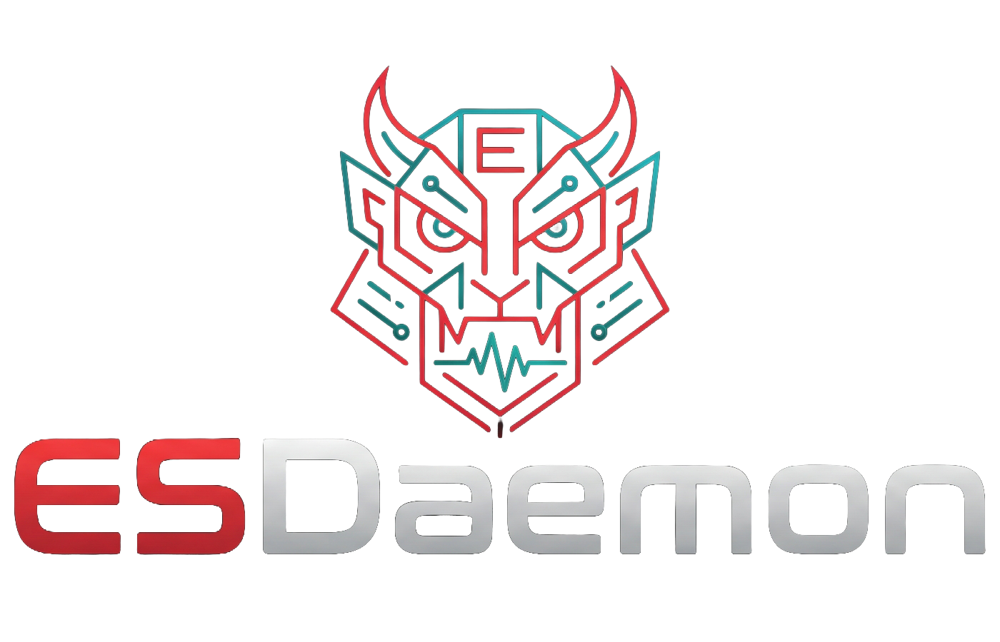

<p align="center">
  
</p>

<h1 align="center">ESDaemon</h1>

<p align="center"><b>macOS endpoint telemetry for your SIEM, built on Apple's own <code>eslogger</code>.</b></p>

ESDaemon turns Endpoint Security events (process starts and logins today; file events and more are on the roadmap) into compact Sysmon-style JSON in the macOS unified log, filtered by a config you control. Any log collector that reads the unified log, such as the Bindplane / OpenTelemetry macOS receiver, ships them to your SIEM.

No kernel extension, no Apple entitlement, no third-party code, no agent to license: it runs `/usr/bin/eslogger`, which ships with macOS.

```
/usr/bin/eslogger ──► ESDaemon filter ([modules], [include] / [exclude]) ──► unified log ──► collector ──► SIEM
   (Apple, FDA)          (jq, Sysmon-style JSON)                          com.apple.eslogger
```

## What it enables

- **Mac visibility in the SIEM you already have.** Who logged in (with source IP for SSH) and what ran (full command line, parent, user, code signature), in Sysmon field names (`EventID`, `Image`, `CommandLine`, `ParentImage`, `User` …) that existing Windows/Sysmon detections and analysts already know. (File events use `TargetFilename` and the same scheme, once that feed ships.)
- **Proof it catches attacks.** A bundled adversary-emulation harness (`redteam/`) runs benign, self-cleaning stand-ins for real macOS techniques (LOOBins, MITRE ATT&CK) and reports which ones ESDaemon logged.
- **Investigations on macOS.** Process trees (`ProcessGuid` / `ParentProcessGuid`), persistence (LaunchAgents and login items), quarantine removal, account changes, SSH logins and failures, all searchable.
- **Control over volume.** Raw `eslogger` output is several GB per Mac per day. ESDaemon logs only the event types you choose and drops what you exclude, with Sysmon's include/exclude rules. The default config drops Apple's own housekeeping: an idle Mac goes from about 95 records per 10 minutes to about 13.
- **Fleet-friendly.** One config file, validated before anything runs, an MDM profile for the one permission it needs, and a filter that never logs itself.

## No third-party dependencies

ESDaemon is bash, the command-line tools that ship with macOS, and one small Swift file. There is no package manager, no third-party library and no vendored code.

- **Scripts** use bash and the tools macOS ships in `/bin` and `/usr/bin`, on its sealed system volume: `eslogger`, `jq` (part of macOS since 15), `launchctl`, `log`, `plutil`, `codesign`, `dscl`, `awk` and the standard POSIX utilities.
- **The writer** (`src/ESDaemon.swift`) imports only Apple's `Foundation` and `os.log`. It is built with Apple's `swiftc` from the Xcode Command Line Tools, or comes prebuilt from this repository's releases. Before it starts the daemons, the installer ad-hoc signs the writer, runs `codesign --verify --strict` on the result, and checks the binary can run on this Mac's architecture; if any of those fail it stops and changes nothing. The signature is **ad-hoc** (`codesign -s -`), **not** a Developer ID signature, and the binary is **not notarized** yet.
- **Network:** none at run time. The only network access is to this repository on GitHub, when you run `quick-install.sh` or `esdaemon update`.

What you trust is macOS and this repository; see [SECURITY.md](SECURITY.md).

## Quick start

On a Mac with macOS 15 or later (`/usr/bin/jq` ships with it):

```bash
git clone https://github.com/VadimV1/ESDaemon.git && cd ESDaemon
sudo ./quick-install.sh
```

or without cloning:

```bash
curl -fsSL https://raw.githubusercontent.com/VadimV1/ESDaemon/main/quick-install.sh | sudo bash
```

**Deploy with MDM (`.pkg`).** For a managed fleet, download `ESDaemon-<version>.pkg` from the [releases page](https://github.com/VadimV1/ESDaemon/releases) and push it with your MDM (Jamf, Kandji, Intune) — which deploys `.pkg`s, not `curl … | sudo bash` — or install one Mac by hand:

```bash
sudo installer -pkg ESDaemon-<version>.pkg -target /
```

The package runs the same `install.sh` as the commands above, so it installs to the same place, keeps a tuned config, and `sudo esdaemon reload` / `sudo esdaemon uninstall` work identically. Pair it with the Full Disk Access profile in [`mdm/`](mdm/) for a one-push deployment. The `.pkg` is **unsigned** today — fine for MDM, which is the trust anchor on managed devices; see [Supply chain trust model](SECURITY.md#supply-chain-trust-model).

> **Trust model — before deploying to a fleet:** this installs and updates as **root** from this repository, tracking `main`, with the binary checksum-verified for transit only, not authenticity. See [Supply chain trust model](SECURITY.md#supply-chain-trust-model).

Then give `/usr/bin/eslogger` **Full Disk Access** (System Settings → Privacy & Security → Full Disk Access, or the MDM profile in [`mdm/`](mdm/)), and watch events arrive:

```bash
log stream --info --predicate 'subsystem == "com.apple.eslogger" AND process == "ESDaemon" AND userIdentifier == 0'
```

Once installed, everything is done through the `esdaemon` command (no scripts to keep around):

```bash
esdaemon status              # running? which version? where is the config?
sudo esdaemon reload         # apply config edits
esdaemon update --install    # check for / install the latest release
sudo esdaemon uninstall      # remove ESDaemon completely, the command itself included
```

`sudo esdaemon uninstall --purge` also deletes the saved config and logs. The standalone `./uninstall.sh` (or `curl -fsSL https://raw.githubusercontent.com/VadimV1/ESDaemon/main/uninstall.sh | sudo bash`) still works for a checkout or a broken install.

On an Intel Mac with Homebrew, `/usr/local/bin` belongs to the Homebrew user, so `esdaemon` is not put on `PATH` there: run it as `sudo /usr/local/ESDaemon/bin/esdaemon` (see [Requirements](#requirements-and-limits)).

**Full walkthrough, including collector setup: [docs/GETTING-STARTED.md](docs/GETTING-STARTED.md).**

## What a record looks like

```json
{"EventID":1,"EventType":"ProcessStart","UtcTime":"2026-10-25 11:42:06.838","GlobalSeqNum":52807,
 "User":"alice","Image":"/usr/bin/curl","CommandLine":"curl -s -o /tmp/x https://example.com/a.sh",
 "CurrentDirectory":"/Users/alice","ProcessId":37700,"ProcessGuid":"{6ADDEB0E-000C-C7E9-0000-000000009344}",
 "ParentImage":"/bin/zsh","ParentCommandLine":"-zsh","ParentProcessId":37389,
 "ResponsibleProcessId":37385,"TerminalSessionId":37389,
 "SigningId":"com.apple.curl","IsPlatformBinary":true,"CDHash":"1AC507E8…"}
```

## The config in one minute

Everything lives in `/usr/local/ESDaemon/configs/ESDaemon.cfg`. Edit, then `sudo /usr/local/ESDaemon/reload.sh`.

```ini
[modules]                 # what to log (supported feeds: process + user — see note below)
process = start
user = login

[include]                 # empty = everything the modules log

[exclude]                 # Sysmon-style rules; exclude always wins
Image is /usr/local/bin/jamf AND CommandLine is "/usr/local/bin/jamf policy -event recurring"
TeamId is any UBF8T346G9;EQHXZ8M8AV
```

| Object | Operations |
|---|---|
| `process` | `start`, `exit`, `inject` |
| `file` | `read`, `write`, `create`, `delete`, `rename`, `attributes` |
| `user` | `login`, `logout`, `sudo`, `account` |
| `system` | `persistence`, `malware`, `kernel`, `mount` |

> **Supported feeds for now:** ESDaemon ships and validates the **process** (`exec`) and **user** (`login`) feeds — the default config enables exactly those. The `file` and `system` modules are recognised by the config DSL but their feeds are **not developed yet**; treat them as experimental and unsupported for now.

- **What the default config logs and drops, and why: [docs/DEFAULT-CONFIG.md](docs/DEFAULT-CONFIG.md)**
- **Every setting, rule field and condition: [docs/CONFIG.md](docs/CONFIG.md)**

## Repository layout

| Path | What |
|---|---|
| `quick-install.sh` | one-step install: fetch, build, install, check |
| `install.sh` | install from a checkout (also installs the `esdaemon` command, on PATH where only root can write) |
| `bin/esdaemon` | the control command (`status`, `reload`, `update`, `logs`, `uninstall`); installed as `/usr/local/ESDaemon/bin/esdaemon`, and in `/usr/local/bin` when only root can write there |
| `uninstall.sh` | standalone removal for a checkout / broken install (an install uses `esdaemon uninstall`) |
| `VERSION`, `REPO` | the release version and the GitHub repository `update.sh` checks |
| `configs/ESDaemon.cfg` | the default config |
| `src/scope.jq` | the filter: modules, include/exclude rules, Sysmon-style records |
| `src/ESDaemon.swift` | writes each record to the unified log (`os_log`, `%{public}@`) |
| `bin/` | `cfg.sh` (parse + validate), `filter.sh`, `reload.sh`, `chain.sh` (checks that only root can change the install tree and the directories above it), `jqcheck.sh` (checks that this Mac's jq runs the filter), `measure.sh` (volume per source), `try.sh` (dry-run a config), `update.sh` (check / install the latest release), `migrate-cfg.sh` |
| `mdm/` | PPPC profile granting `eslogger` Full Disk Access |
| `test/` | `make test`: filter, config and format tests (macOS or Linux, needs `jq`) |
| `redteam/` | adversary-emulation harness: benign, self-cleaning macOS attack techniques that confirm ESDaemon logs them ([redteam/README.md](redteam/README.md)) |
| `docs/` | getting started, default config, config reference, testing on a Mac |

## Requirements and limits

- macOS 15.0 or later, Apple silicon or Intel, with the `/usr/bin/jq` that comes with it: the filter runs on it. Building needs Xcode Command Line Tools, unless you use a prebuilt release binary.
- Tested with `jq-1.7.1-apple`, the `/usr/bin/jq` of macOS 15.7 and 26: CI runs every test against it. Earlier macOS 15 releases, whose jq may be older, are not tested. The installer and `esdaemon reload` run the filter on this Mac's jq, with the config, before they change anything, and stop if it cannot run it.
- Only root may be able to write to `/usr/local` and the directories above it (the macOS default): the daemons run as root from `/usr/local/ESDaemon`. The installer, `esdaemon reload` and `esdaemon status` check this; the installer and reload stop without changing anything if another user could change the install tree or a directory above it, and print the command that fixes each path.
- Homebrew on an Intel Mac: `/usr/local/bin` belongs to the Homebrew user. Leave it as it is: the installer then puts no `esdaemon` command there, and you run it as `sudo /usr/local/ESDaemon/bin/esdaemon`. If `/usr/local` itself belongs to your user (older Homebrew installs did that), give it back to root: `sudo chown root:wheel /usr/local && sudo chmod 755 /usr/local`. Current Homebrew needs only the subdirectories it owns.
- `eslogger` needs Full Disk Access; ESDaemon's own filter does not.
- Network connections are not an `eslogger` event; use DNS or proxy telemetry for those.
- The filter sees every event locally (a little CPU); what it saves is the bytes shipped and stored.

## Contributing, security, license

See [CONTRIBUTING.md](CONTRIBUTING.md) and [SECURITY.md](SECURITY.md). Released under the [MIT License](LICENSE).
